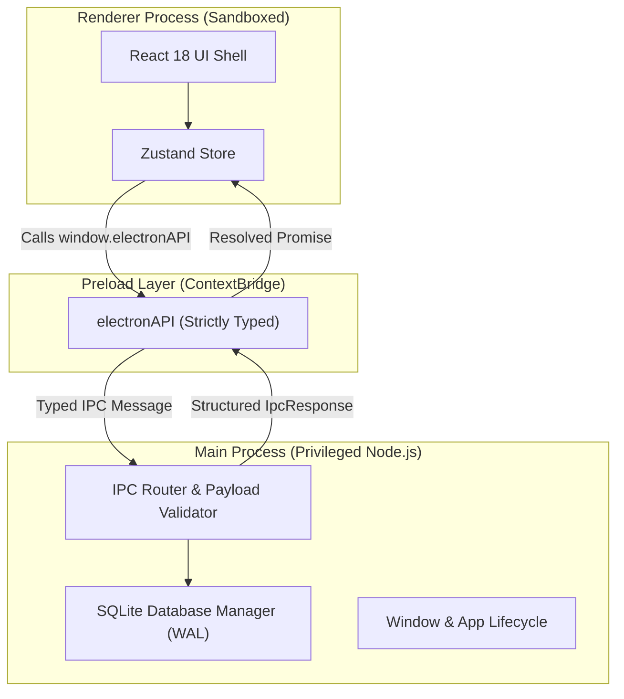

# DevPilot API Studio — Architecture Specification

## 1. Multi-Process Separation

DevPilot strictly adheres to official Electron security architecture:

### Security Boundaries:
1. **Context Isolation:** Enabled (`contextIsolation: true`). The renderer cannot access Node.js internals or DOM prototypes of the preload script.
2. **Node Integration:** Disabled (`nodeIntegration: false`).
3. **Sandboxing:** Enabled (`sandbox: true`).
4. **Content Security Policy (CSP):** Configured via session headers.
5. **Safe IPC Invocations:** Every incoming message is strictly validated by `validateIpcPayload()` before routing to the database or system service.

---

## 2. Local Persistence & Database Schema

Local data is stored in the user's application data directory (`userData/devpilot.sqlite`).

### SQLite Pragmas:
- `PRAGMA journal_mode = WAL;` (Concurrent reads and writes, crash resilience)
- `PRAGMA foreign_keys = ON;` (Referential integrity enforcement)

### Schema Tables:
- `schema_migrations`: Migration tracking (`id`, `name`, `applied_at`).
- `workspaces`: High-level organizational workspaces (`id`, `name`, `description`, `sort_order`).
- `collections`: Groups of requests (`id`, `workspace_id`, `name`, `auth_config_json`, `variables_json`).
- `folders`: Hierarchical folders within collections (`id`, `collection_id`, `parent_folder_id`, `name`).
- `requests`: Request configurations (`id`, `collection_id`, `folder_id`, `name`, `method`, `url`, `headers_json`, `params_json`, `body_json`).
- `environments`: Variables per environment (`id`, `workspace_id`, `name`, `variables_json`, `is_active`).
- `settings`: Key-value application preferences (`theme`, `timeoutMs`, `followRedirects`, `strictSSL`).
