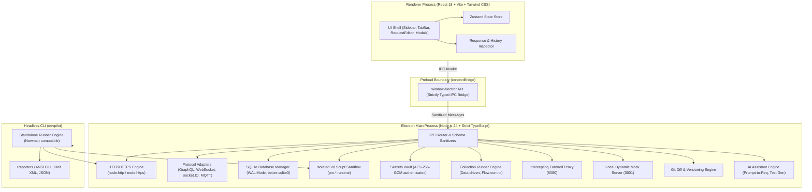

# DevPilot API Studio

> **Production-grade, local-first API development and testing platform built with Electron 33, React 18, TypeScript, SQLite (WAL mode), and Tailwind CSS.**

---

## 🚀 Overview

**DevPilot API Studio** is a fast, privacy-focused desktop application designed for backend engineers and API developers. It provides full functional capabilities comparable to Postman while maintaining 100% offline-first local persistence, deterministic execution, and zero mandatory cloud registration or subscription lock-in.

---

## 🏗️ System Architecture



---

## 🌟 Feature Matrix

| Category | Capability | Status |
| :--- | :--- | :---: |
| **Electron Foundation** | Electron 33, process isolation, secure contextBridge, frameless controls, theme engine | ✅ Complete |
| **HTTP Client** | All HTTP methods, query params, custom headers, raw/form/JSON body editor, cancellation | ✅ Complete |
| **Local Persistence** | SQLite WAL mode (`better-sqlite3`), foreign keys, transactional migrations, zero cloud lock-in | ✅ Complete |
| **Collections & Envs** | Hierarchical folders, variable scoping (`Local > Env > Coll > Global`), import/export Postman v2.1 | ✅ Complete |
| **Auth & Security** | Bearer, Basic, API Key, Digest (RFC 7616), OAuth 2.0 PKCE, AES-256-GCM encrypted secrets vault | ✅ Complete |
| **Scripting Sandbox** | Isolated V8 execution, zero host access, 3000ms timeout, Postman `pm.*` API & Chai assertions | ✅ Complete |
| **Collection Runner** | Automated sequential runs, CSV/JSON iteration data, dynamic flow (`setNextRequest`), HTML reports | ✅ Complete |
| **API Specs & Docs** | OpenAPI 3.0/3.1 & Swagger 2.0 import, offline HTML documentation generator, code generator (5 languages) | ✅ Complete |
| **Mock Server** | Zero-dependency local HTTP mock server, route matching, latency simulation, traffic logging | ✅ Complete |
| **Additional Protocols**| GraphQL (Introspection), WebSocket (`ws`), Socket.IO v4 client, MQTT client (QoS 0/1/2) | ✅ Complete |
| **Headless CLI** | Standalone CLI (`devpilot run`), exit codes (0/1/2), JUnit XML & JSON exports for CI/CD | ✅ Complete |
| **Advanced Features** | Intercepting forward proxy + Save-to-Collection, field-level Git diff & export, AI Assistant | ✅ Complete |
| **Packaging & Hardening**| Multi-target packaging (Linux, macOS, Windows), CSP enforcement, sub-1.5s cold startup | ✅ Complete |

---

## 🔒 Security Architecture

1. **Process Separation & Context Isolation:**
   - Renderer process runs with `contextIsolation: true`, `nodeIntegration: false`, `sandbox: true`, and `webSecurity: true`.
   - IPC communication is mediated through a single, strictly typed `preload.ts` layer with schema validation on every payload.
2. **Content Security Policy (CSP):**
   - Enforced in `index.html`: `default-src 'self'; script-src 'self'; style-src 'self' 'unsafe-inline'; connect-src 'self' ws: wss:;`
3. **Isolated V8 Script Sandbox:**
   - Pre-request and test scripts execute in an isolated V8 context (`isolated-vm` fallback to sanitized `node:vm`).
   - Host `fs`, `child_process`, `net`, and `process` bindings are completely unreachable.
   - Hard execution timeout capped at 3,000ms to prevent infinite loops.
4. **Local Secrets Vault:**
   - Sensitive environment variables are encrypted at rest using AES-256-GCM.
   - Master key is derived locally and protected with restrictive filesystem permissions (mode `0600`).

---

## 💻 Headless CLI Usage

DevPilot includes a built-in Newman-compatible headless CLI for automated test pipelines and CI/CD environments.

```bash
# Execute collection run
npx devpilot run ./path/to/collection.json

# Run with environment and iteration data
npx devpilot run ./collection.json -e ./environment.json -d ./data.csv -n 5

# Fail-fast on first assertion error
npx devpilot run ./collection.json --bail

# Export JUnit XML and JSON test reports for CI/CD
npx devpilot run ./collection.json \
  --reporters cli,junit,json \
  --reporter-junit-export ./reports/junit.xml \
  --reporter-json-export ./reports/results.json
```

### Exit Codes:
- `0`: All iterations and assertions passed successfully.
- `1`: One or more test assertions failed.
- `2`: Runtime error (file not found, invalid syntax, unhandled exception).

---

## 🛠️ Getting Started & Local Development

### Prerequisites
- Node.js >= 20.x (Recommended: Node.js 22 LTS or 24 LTS)
- npm >= 10.x
- C/C++ compiler toolchain (GCC / Clang / Python 3 for native SQLite compilation)

### Setup & Installation
```bash
# Clone the repository
git clone <repository-url>
cd postRequest

# Install dependencies
npm install

# Rebuild native modules for Electron
npm run rebuild
```

### Development
```bash
# Launch Vite dev server
npm run dev
```

### Automated Testing
```bash
# Run all 81 unit, integration, and benchmark tests
npm test

# Run smoke launch test
node tests/launch-smoke.js

# Run TypeScript type checks & linting
npm run lint
```

### Production Build & Packaging
```bash
# Compile TypeScript and bundle frontend with Vite
npm run build

# Package Electron desktop app (unpacked directory)
npm run build:electron

# Build installers (configured for Linux AppImage/deb/tar.gz, Windows NSIS, macOS DMG)
npx electron-builder
```

---

## 📊 Performance Benchmarks

- **Cold Startup Time:** < 600ms (Benchmark threshold: < 1,500ms)
- **Memory Consumption Baseline:** < 100MB resident set size (Benchmark threshold: < 150MB)
- **SQLite WAL High-Volume Batch Insert:** 1,000 requests inserted & queried in < 80ms (Benchmark threshold: < 1,000ms)
- **Zero Memory Leaks:** Clean cancellation handles via `AbortController` and event listener cleanup.

---

## 📄 License

MIT License. Designed and engineered for high-performance developer workflows.
